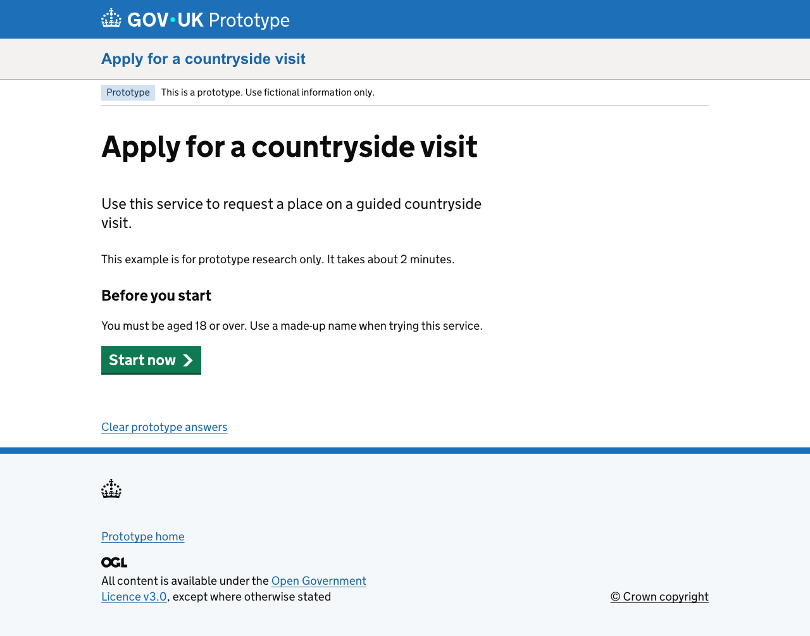

<div align="center">

# GOV.UK Static Prototype Kit

**Government service prototypes. Static hosting. Familiar tools.**

Build multi-page journeys with Eleventy, Nunjucks and official GOV.UK Frontend components. Save fictional answers in the browser, test different routes, and publish static files to GitHub Pages.

[](https://github.com/doideaco/GOV.UK-Static-Prototype-Kit/actions/workflows/ci.yml)
[](LICENSE)

[Get started](#get-started) · [How it works](#how-it-works) · [Author a journey](#author-a-journey) · [Publish](#publish-to-github-pages) · [Security](#sharing-and-security)

</div>



## Why this exists

A prototype should be easy to start, change and share. For a journey made of pages, questions and a few branches, running an application server can add more operational work than the research needs: hosting accounts, server configuration, deployment maintenance and another service to keep running.

This kit explores a smaller foundation. Generate the pages ahead of time, use the browser for fictional answers and simple journey decisions, and publish the result as static files. Node runs on a designer's computer and in the build pipeline; visitors do not need a Node server running behind their prototype.

The aim is to retain useful parts of the GOV.UK prototyping experience—Nunjucks pages, official components, editable journeys and check your answers—while making public, non-sensitive prototypes straightforward to host. GitHub Pages is the default deployment target, with no separate application-hosting bill for typical public prototypes within GitHub's limits.

Initially oriented towards Defra service teams, the starter is intended for designers, content designers, researchers and developers exploring government service journeys. It is an independent project, not an official GOV.UK or Defra product.

> **Use fictional information only.** Never use GitHub Pages + the client-side demo gate for real personal data, confidential research, unpublished sensitive policy, or protected internal material. The gate is a convenience screen, not access control. See [sharing and security](#sharing-and-security).

## What you get

- **Official GOV.UK Frontend:** npm-provided Nunjucks macros, styles, fonts, images and JavaScript. Components are not copied or reimplemented.
- **An editable starter service:** start → name → eligibility → check your answers → confirmation, with an ineligible branch and change-answer links.
- **Browser answers:** session storage by default, optional local storage, form restoration and a clear-answers action.
- **Declarative journeys:** YAML rules for branching, with build-time checks for invalid routes and unsupported conditions.
- **Encrypted publishing by default:** the GitHub Pages workflow encrypts the complete generated site, with an explicit opt-out for public plaintext publishing.
- **Research scenarios:** shareable, allowlisted scenario IDs with invented answers and predictable reset behaviour.
- **Static deployment:** clean page URLs, one base-path helper, and a GitHub Actions workflow for repository sites and root/custom domains.
- **Checks:** TypeScript, Vitest, Playwright, axe checks, root/subpath coverage and opt-in visual comparisons.

This is a working starter repository. It is not a drop-in replacement for the Express-based GOV.UK Prototype Kit, a migration tool for existing prototypes, or a foundation for production application processing.

## Get started

Use **Node.js 24** for the same version as CI. The package requires Node.js 22 or later.

```sh
git clone https://github.com/doideaco/GOV.UK-Static-Prototype-Kit.git
cd GOV.UK-Static-Prototype-Kit
npm install
npm run dev
```

Open **[localhost:8080](http://localhost:8080)**. The home page links to the starter journey and the fictional research scenarios.

To start your own project, create a repository from this one using GitHub's template feature if enabled, or copy/fork it and update the Git remote. There is no `npm create` generator yet.

### Enable encrypted publishing

**GitHub Pages publishing is encrypted by default.** Local development stays simple: `npm run dev` and `npm run build` still generate the ordinary plaintext prototype locally.

Before the first deployment:

1. Open your repository's **Settings → Secrets and variables → Actions → Secrets**.
2. Choose **New repository secret**, name it `ENCRYPTION_PASSPHRASE`, and enter a long, unique, randomly generated passphrase of **at least 20 characters**. Do not put this passphrase in source code, site.yaml, a URL or a repository variable.
3. Under **Settings → Pages → Build and deployment**, select **GitHub Actions**.
4. Push to `main`, or run **Deploy GitHub Pages** from the Actions tab. Share the passphrase separately with your research participants.

No publishing-mode variable is required. If `PROTOTYPE_PUBLISH_MODE` already exists, set it to `encrypted` or delete it to use the default. A missing/short secret stops deployment; plaintext is never used as a fallback. Failed deployment does not remove any version already published.

To build an encrypted export on your own computer, run `npm run build:encrypted`; it prompts for the passphrase with input hidden. Publish only `_encrypted/`. See the [encrypted export guide](docs/encrypted-export.md) for previews, limitations and the threat model.

To **deliberately publish a public, unencrypted prototype**, add an Actions repository **variable** named `PROTOTYPE_PUBLISH_MODE` with value `static`. This uploads readable `_site/` output; the convenience gate does not protect it. Setting `encrypted` explicitly is also supported.

### Make your first change

1. Change the service name and `prototypeId` in [`src/data/site.yaml`](src/data/site.yaml).
2. Edit the starter content in [`src/pages/example/`](src/pages/example).
3. Update destinations and conditions in [`src/data/journeys.yaml`](src/data/journeys.yaml).
4. Replace the fictional presets in [`src/data/scenarios.yaml`](src/data/scenarios.yaml).
5. Walk through the journey locally, then run the checks below.

Development watches templates, styles, scripts and configuration. Use a distinct prototype ID for each project; increase `schemaVersion` when changes make old stored answers incompatible.

## How it works

```text
Nunjucks pages + YAML configuration + official GOV.UK Frontend
                            │
                 Eleventy + Sass + esbuild
                            │
                         _site/
                    HTML, CSS, JS, assets
                            │
              GitHub Pages / another static host
                            │
       Browser: save answers → evaluate rules → next page
```

The build validates page permalinks, journey destinations and conditions, then embeds the journey/scenario manifest in the generated HTML. The browser runtime restores answers, validates a submitted form, saves its values, evaluates the next step and navigates to another generated page.

There is no backend API, database, server session or hosted state service. An example “send” button completes the fictional journey; it does not submit an application to a real service.

### Why these choices?

| Decision | Rationale | Trade-off |
| --- | --- | --- |
| Eleventy + Nunjucks | Generate ordinary HTML and use the official component macros directly. | Templates run at build time; they cannot automatically read browser answers. |
| A small TypeScript runtime | Add persistence and branching without making the site a SPA. | Stateful journeys require JavaScript. |
| YAML journey rules | Make simple branches visible and editable outside application code. | Complex server behaviour and arbitrary rule scripts are outside this kit's scope. |
| Session storage by default | Keep fictional answers within the browser tab's session. | Answers can be cleared, modified or blocked by the browser; they are not secure records. |
| GitHub Pages | Publish a folder of static files through a repeatable repository workflow. | Public Pages hosting cannot enforce the included client-side gate. |
| Official GOV.UK dependencies | Preserve component fidelity and make upstream upgrades explicit. | Dependency updates need testing and visual review. |

The [architecture decisions](docs/decisions.md) record these boundaries in more detail.

## Author a journey

### 1. Add a page

Create a `.njk` file under `src/pages`. Give it a layout, title and unique directory-style permalink. Use the `url` filter for **every internal URL**, including assets, back links and form actions.

```njk
---
layout: layouts/service.njk
title: What is your name?
permalink: /my-service/name/
---



<form data-journey action="{{ '/my-service/review/' | url }}" novalidate>
  <div data-errors></div>

  {{ govukInput({
    id: 'full-name',
    name: 'full-name',
    label: {text: 'What is your name?', isPageHeading: true, classes: 'govuk-label--l'},
    hint: {text: 'Use a made-up name for this prototype.'},
    attributes: {'data-required': 'Enter your name'}
  }) }}

  {{ govukButton({text: 'Continue'}) }}
</form>
```

Create the review page too, then register both routes in the journey configuration. The build rejects unknown destinations and duplicate permalinks. See the [starter pages](src/pages/example) for complete examples.

### 2. Connect the steps

`src/data/journeys.yaml` declares routes and next steps. A simple step has a string destination; a branching step has ordered conditions and a final `otherwise` destination.

```yaml
journeys:
  example:
    steps:
      - path: /example/name/
        next: /example/eligibility/
      - path: /example/eligibility/
        next:
          - when:
              field: eligible
              equals: 'yes'
            path: /example/check-answers/
          - otherwise: /example/ineligible/
      - path: /example/check-answers/
        next: /example/confirmation/
      - path: /example/ineligible/
      - path: /example/confirmation/
```

Supported conditions are `equals`, `notEquals`, `in`, `exists`, `all` and `any`. The runtime evaluates data rules; it does not execute JavaScript strings. Conditions are ordered, and the first matching branch wins. Quote YAML values such as `'yes'` and `'no'` to make their intended string type clear.

### 3. Show browser answers

Build-time template data and runtime answers are separate. A Nunjucks expression cannot read a participant's session storage while the site is being built.

Use a binding for browser answers:

```html
<span data-answer="full-name">Not provided</span>
```

Values are inserted with `textContent`, so answer text is not interpreted as HTML. Arrays display as comma-separated values. For conditional content on page load:

```html
<p data-show-when='{"field":"eligible","equals":"yes"}' hidden>
  You can continue with this fictional application.
</p>
```

Bindings and conditions are refreshed on page load, rather than acting as a reactive framework while controls change.

### Form behaviour

| Controls | Stored value |
| --- | --- |
| Text inputs, textareas and single selects | A string; leading/trailing whitespace is trimmed on submission. |
| Radio groups | The selected string, or `''` if none is selected. |
| Checkbox groups and multiple selects | An array, including `[]` when nothing is selected. |
| Repeated text inputs with the same name | An ordered array of values. |
| Disabled, file and password controls | Excluded from saved answers. |

Add `data-required="Your error message"` to a required control, or the first radio in a required group. Include `<div data-errors></div>` in the form. Validation provides inline errors, links to affected controls and focus on an error summary. The starter implements required-field checks; add explicit validation and tests for more complex constraints.

The sample check-your-answers page uses `?return=check-answers` on change links. This is an allowlisted return destination in the starter runtime, not an arbitrary redirect URL. Editing eligibility to “No” follows the ineligible branch. Adapt this sample-specific return logic when creating another service. Visible back links have explicit destinations; normal browser history remains available.

## Research scenarios and storage

Scenarios in [`src/data/scenarios.yaml`](src/data/scenarios.yaml) contain **invented information** and a starting route. Append an allowlisted ID to a prototype URL:

```text
/example/start/?scenario=eligible-applicant
/example/start/?scenario=ineligible-applicant
```

A scenario replaces stored answers, records its active ID and navigates to its start page. The query parameter is removed, so refreshing or moving between pages does not silently reapply it. Opening the scenario URL again deliberately reapplies the preset. **Clear prototype answers** removes both answers and the active-scenario marker.

Development displays the active scenario; `NODE_ENV=production` hides that notice. Scenario IDs and their fictional presets are public in the generated site. Do not put participant details in scenario definitions or URLs.

### Choose how long answers persist

Both options work on GitHub Pages without a backend. Configure them in [`src/data/site.yaml`](src/data/site.yaml), then rebuild and redeploy for the change to reach the published prototype.

| Setting | Where answers survive | When to use it |
| --- | --- | --- |
| `storage: session` (default) | Page navigation and reloads within the same tab session. | Ordinary research sessions where answers should not normally carry over to a later visit. |
| `storage: local` (optional) | Later visits and browser restarts in the same browser profile and on the same origin, until cleared or removed by the browser. | Fictional journeys that researchers want to leave and resume later. |

To enable persistence across visits:

```yaml
prototypeId: my-service-prototype
schemaVersion: 1
storage: local
resetOnStart: false
```

To use the default tab-session behaviour, set `storage: session`. Keep `resetOnStart: false` when you want to resume saved answers. Setting it to `true` clears answers whenever the sample `/example/start/` page loads without a scenario parameter; it does not automatically reset every custom start route.

### Scope, clearing and research use

- Answers stay in the visitor's browser profile and device. They are not uploaded to GitHub, shared between participants, synchronised across devices or available as research results to the prototype author.
- Local storage is shared by tabs on the same origin. It is not separate participant storage: use **Clear prototype answers** between participants sharing a browser. Simultaneous tabs can overwrite one another's answers; there is no live cross-tab synchronisation.
- **Clear prototype answers** deletes saved answers from the selected storage and removes the active-scenario marker. In encrypted mode, **Lock prototype** also clears saved answers, including local-storage answers. Locking therefore ends the saved journey rather than offering “lock and resume”.
- Storage keys are namespaced as `govuk-static-kit:<prototypeId>:v<schemaVersion>`. Use a unique `prototypeId` for each prototype to avoid collisions. GitHub Pages repository paths under the same owner's host share an origin; namespacing prevents accidental collisions, not access by other scripts on that origin.
- Increasing `schemaVersion` starts a new answer namespace; it does not migrate or erase the old namespace. Changing storage modes also does not migrate or clear answers from the previous storage. Clear answers before switching modes or deliberately clean up old prototype keys when needed.
- Browser settings, private browsing and storage eviction can prevent persistence or remove data. If storage is unavailable, the runtime falls back to page-local memory and answers will not survive navigation. Browsers may restore session storage when reopening tabs, so closing a tab is not a reliable data-erasure mechanism.

### Saved answers and encrypted publishing are separate

`storage: local` works with encrypted export, but **saved answers are still readable JSON in browser storage**. Export encryption protects the published prototype files; it does not encrypt answers entered during a visit.

The encryption unlock key always uses **sessionStorage**, regardless of the answer-storage setting. Choosing local storage does not enable a permanent “remember my passphrase” option. The raw passphrase is never stored. A later visit may require unlocking again before previously saved local answers are restored, provided they were not cleared or removed by the browser. Other unlocked tabs retain their own session credentials when one tab locks.

Use fictional answers only. Local storage is a convenience for resuming a prototype, not a secure place for participant information or government data.

## Publish to GitHub Pages

1. Use a GitHub repository with `main` as the deployment branch.
2. Add the Actions repository secret `ENCRYPTION_PASSPHRASE` as described in [enable encrypted publishing](#enable-encrypted-publishing).
3. In **Settings → Pages → Build and deployment**, select **GitHub Actions**. Ensure Actions are enabled.
4. Push to `main`, or manually run **Deploy GitHub Pages** from the Actions tab.
5. Open the URL reported by the deployment job and unlock it with your passphrase. A local build alone does not publish a site.

For this repository, the project-site URL would normally be `https://doideaco.github.io/GOV.UK-Static-Prototype-Kit/` once Pages is enabled and deployment succeeds. This is a destination example, not a claim that the site is already live.

The [deployment workflow](.github/workflows/deploy-pages.yml) installs locked dependencies, asks GitHub for the Pages base path, builds and encrypts the prototype, uploads only `_encrypted/` and deploys it. An explicit `PROTOTYPE_PUBLISH_MODE=static` opt-out instead publishes `_site/`. It requests `contents: read`, `pages: write` and `id-token: write`. The separate [checks workflow](.github/workflows/ci.yml) verifies the kit on pushes and pull requests; deployment does not currently wait on that workflow, so configure branch protection if checks must gate releases.

After editing an existing checkout:

```sh
git add .
git commit -m "Update prototype journey"
git push origin main
```

### Repository paths, root domains and other hosts

Every internal URL goes through one base-path helper. You can reproduce a repository-site build locally:

```sh
BASE_PATH=/GOV.UK-Static-Prototype-Kit/ npm run build
BASE_PATH=/GOV.UK-Static-Prototype-Kit/ node tooling/check-output.mjs
```

For a root/custom domain, build with `BASE_PATH=/`. Configure the custom domain in GitHub Pages settings and its DNS records. Do not hardcode a repository name into page templates.

The same `_site/` output can be deployed to another static host. For Netlify or Cloudflare Pages, use `npm run build`, output directory `_site` and `BASE_PATH=/` when serving at the root. Hosting-specific authentication is a separate configuration concern.

## Sharing and security

### Included today: a convenience gate

The optional demo gate is **disabled by default**. Enable it in `src/data/site.yaml`:

```yaml
publicDemoGate:
  enabled: true
  passphrase: fictional-demo
```

This is intentionally a public demo passphrase. Entry is remembered in session storage, direct page links show the gate, and **Leave prototype** clears the entry marker. The underlying interface is hidden before normal page rendering; the gate requires JavaScript.

**The passphrase, HTML, scripts, assets and fictional scenario data are still recoverable by anyone with the URL.** Visitors can bypass the gate or forge the browser marker. A private source repository does not by itself make a publicly published Pages site private. Do not store actual secrets in frontend configuration or GitHub's public build artefacts.

### Default: encrypted publishing

GitHub Pages publishing uses encryption by default. It protects the generated pages, embedded scenarios, scripts, styles and custom assets inside one authenticated encrypted payload. Public routes show a generic GOV.UK unlock screen; the browser decrypts the content after entry. No raw passphrase or decryption key is included in the deployment.

```sh
npm run build:encrypted
npm run preview:encrypted
```

The build prompts for a strong, unique passphrase with input hidden (minimum 20 characters). Publish **only `_encrypted/`**. Ordinary development and `npm run build` still use plaintext `_site/` locally.

For GitHub Pages, add an Actions repository secret named `ENCRYPTION_PASSPHRASE`, then run the deployment workflow. No mode variable is needed: the default is `encrypted`. Missing/short credentials stop deployment without a plaintext fallback. Only an explicit Actions variable `PROTOTYPE_PUBLISH_MODE=static` selects public plaintext output; review changes to that setting.

Unlocking is remembered in sessionStorage for the current tab using a derived decryption key. **Lock prototype** clears that key and the prototype's fictional answers, even when `storage: local` is enabled. Answer storage remains separate and unencrypted; see [saved answers and encrypted publishing](#saved-answers-and-encrypted-publishing-are-separate). The key is itself an access credential; untrusted scripts on the same origin can endanger it.

**This repository's starter source and screenshots are already public.** Encrypting a deployment cannot make those copies secret. Use a separate private source repository for withheld designs, review all publication channels and choose a long random passphrase: downloaded ciphertext permits offline password guessing. There is no individual access revocation, and downloaded copies cannot be recalled. JavaScript and HTTPS (or localhost) are required.

Read the [encrypted export guide](docs/encrypted-export.md) for the exact publishing setup, browser behaviour, supported asset patterns and threat model. This mode is not a replacement for authenticated hosting of sensitive material.

### For material that requires access control

Use organisational authenticated hosting, or an access service configured to protect **every file before delivery**. Disable any alternative public origin and verify unauthenticated HTML, asset and deep-link requests are rejected. Browser storage still needs a separate privacy assessment. See [`SECURITY.md`](SECURITY.md).

## Commands and checks

| Command | What it does |
| --- | --- |
| `npm run dev` | Build assets, watch source and serve the prototype locally. |
| `npm run build` | Generate the static site in `_site/`. |
| `npm run build:encrypted` | Prompt for a passphrase (or use the CI secret), build and encrypt the complete site into `_encrypted/`. |
| `npm run preview:encrypted` | Serve a root-path encrypted build locally on port 8080. |
| `npm run test:encrypted` | Verify encrypted publishing and journeys at a dotted repository subpath on an isolated port. |
| `npm run preview` | Serve the existing `_site/` output on port 8080; does not rebuild. |
| `npm run check` | Typecheck, run unit tests, build, validate configuration and check local generated URLs. |
| `npm run test:e2e` | Run desktop/mobile browser journeys, form-control and axe checks against built output. |
| `npm run test:subpath` | Rebuild for `/sample-repo/` and run browser tests at that path. |
| `npm run test:gate` | Rebuild with the demo gate and test deep links, errors, refresh, sign-out and its explicit bypassability. |
| `npm run test:visual` | Compare start, name and summary screenshots at desktop/mobile sizes. |

Install Chromium once before browser tests:

```sh
npx playwright install chromium
```

A complete local verification run:

```sh
npm run check
npm run test:e2e
npm run test:subpath
BASE_PATH=/sample-repo/ node tooling/check-output.mjs
npm run test:gate
npm run test:encrypted
npm run build
npm run test:visual
```

**Stop any development or preview server first**, so Playwright can start a test server with the correct base path. Subpath and gate suites leave their specialised output in `_site/`; the final normal build restores the default root-path, ungated configuration.

Gate and visual cases are intentionally skipped by the ordinary e2e command and run through their dedicated commands. The supplied visual baselines are for macOS Chromium. On another platform, create and review baselines with `npm run test:visual -- --update-snapshots`. Screenshot comparisons are opt-in and do not run in the Linux CI workflow yet.

### Accessibility, privacy and dependency updates

The kit uses GOV.UK patterns and automated axe checks, but automation does not establish WCAG 2.2 AA compliance. Manually check keyboard order, validation recovery, screen-reader announcements, 200–400% zoom, mobile reflow and the no-JavaScript experience when adapting a journey.

Static content remains readable without JavaScript where practical. Saving answers, evaluating branches, scenarios, runtime bindings and the demo gate require JavaScript. No analytics or third-party runtime requests are configured by default.

Dependency versions are pinned and [Dependabot](.github/dependabot.yml) proposes updates. For GOV.UK Frontend changes, review release notes, confirm installed macro/asset paths, run the checks and root/subpath browser suites, and review desktop/mobile screenshots. Keep baseline updates reviewable alongside the dependency change. See [contributing](CONTRIBUTING.md).

## Project map

```text
src/
  _includes/layouts/    Shared page shell and official macro integration
  pages/               Nunjucks pages with front matter and permalinks
  data/                Site settings, journeys and fictional scenarios
  assets/scripts/      Browser runtime, storage and form handling
  assets/styles/       GOV.UK styles and small local overrides
tooling/               Eleventy configuration, build pipeline and rule validation
tests/unit/            Rule evaluation, route validation and storage tests
tests/e2e/             Journey, control, gate, accessibility and visual tests
docs/                  Architecture, encrypted publishing guide and README imagery
.github/workflows/     Checks and GitHub Pages deployment
_site/                 Generated plaintext output; ignored by Git
_encrypted/            Default Pages publishing output; ignored by Git
```

## Implementation and next steps

The initial implementation follows four stages:

| Stage | Delivered |
| --- | --- |
| Static foundation | Eleventy/Nunjucks, official GOV.UK Frontend integration, styles/assets, base-path helper, sample pages and Pages workflow. |
| Stateful journeys | Browser persistence, form restoration, safe answer bindings, YAML branches, validation and check-your-answers editing. |
| Research tools | Fictional scenario URLs and the optional, explicitly bypassable demo gate. |
| Release foundation | Authoring/security documentation, architecture decisions, pinned dependencies, automated checks and visual baselines. |

Encrypted export is the default GitHub Pages publishing mode with complete-file encryption, a generic unlock screen, tab-session unlocking, a lock action, CI-secret support and dedicated browser tests. See its [implementation and limitations](docs/encrypted-export.md).

Useful next work includes making change-answer return routes fully configurable, broadening validation beyond required fields, and establishing reviewed Linux visual baselines for CI. These are future improvements, not capabilities claimed by the current kit.

## Troubleshooting

- **Deployment fails because an encryption credential is missing:** add `ENCRYPTION_PASSPHRASE` under Actions repository secrets (minimum 20 characters), then rerun deployment. Do not set it as a variable or commit it.
- **A page or its styles returns 404 after deployment:** check that `BASE_PATH` matches the hosted path, use the `url` filter, and run the local URL checker with that same base.
- **A form does not save or navigate:** ensure JavaScript is enabled, the form has `data-journey`, its controls have names, and the page's permalink appears in the journey configuration.
- **A scenario seems to have disappeared:** it applies once and removes the URL parameter. Reopen its scenario URL to deliberately reapply it, or clear answers to start fresh.
- **Browser tests fail while development is running:** stop the server on port 8080; the test suite needs to serve its own root/subpath build.
- **An upstream component looks different:** inspect the pinned GOV.UK Frontend version and review the screenshot differences before updating baselines.

## Licence and attribution

Kit code is [MIT licensed](LICENSE). GOV.UK Frontend and other dependencies retain their own licences and usage conditions; the kit's licence does not grant rights to government branding. See [third-party notices](THIRD-PARTY-NOTICES.md) before redistributing or publishing.
