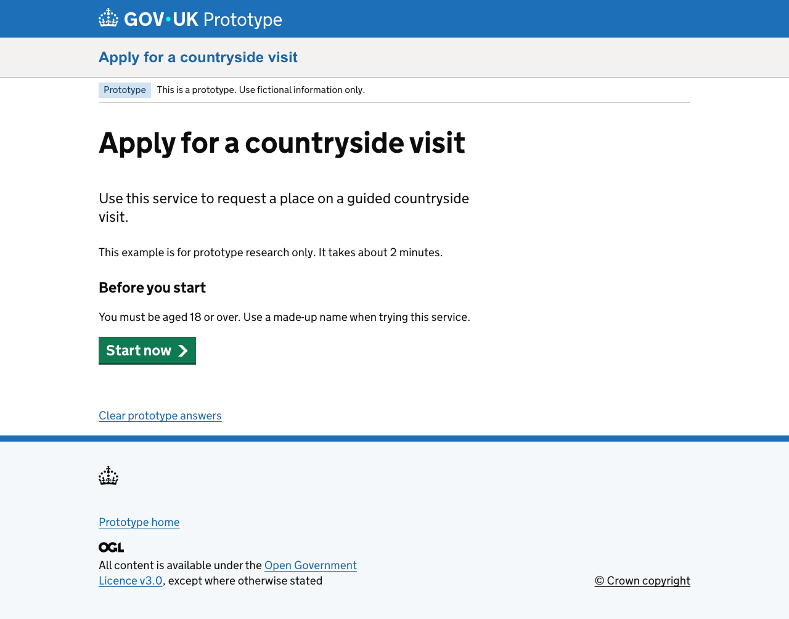

# A designer's guide to the Static Prototype Kit

Use this kit to turn a service journey into pages people can try in a browser. You can change content, ask questions, save fictional answers and test different routes without building a backend service.

You do not need to understand the whole codebase. Start with the sample journey, change one thing at a time and keep checking what a participant sees.

## Choose where to start

| I want to… | Read |
| --- | --- |
| Get the kit running and change my first page | [Your first prototype](getting-started.md) |
| Choose standard, inline-radio or YAML routing | [Choose your form routing](routing-and-forms.md) |
| Add a question, connect pages or change a branch | [Build and edit a journey](building-a-journey.md) |
| Prepare scenarios, choose answer storage or share with participants | [Research and sharing](research-and-sharing.md) |
| Understand the architecture or run the full technical checks | [Main README](../../README.md) |
| Understand encryption's security boundaries | [Encrypted export guide](../encrypted-export.md) |

For a first session, follow **Your first prototype**, then work through the **Add a question** exercise. It keeps the existing journey structure so you can learn the kit without changing its browser runtime.

## The basic idea

- **Pages** contain the content and questions people see.
- **A journey file** says which page comes next and when a branch is taken.
- **The browser** remembers fictional answers while someone tries the prototype.
- **Publishing** builds those files and puts an encrypted version on GitHub Pages by default.

A prototype can look and behave like a service without actually submitting anything. The sample's final button does not send an application to Defra or any other organisation.

## The files you will use most

| File or folder | What you change there |
| --- | --- |
| [`src/data/site.yaml`](../../src/data/site.yaml) | Service name, prototype identifier and answer-storage settings. |
| [`src/pages/example/`](../../src/pages/example) | Page content, questions, hints and button text. |
| [`src/data/journeys.yaml`](../../src/data/journeys.yaml) | Page order and conditional branches. |
| [`src/data/scenarios.yaml`](../../src/data/scenarios.yaml) | Invented answers and starting points for research. |
| [`src/pages/index.njk`](../../src/pages/index.njk) | The prototype home page and links to scenarios. |

Edit source files in `src/`. Do not edit `_site/`, `_encrypted/`, `build/` or `node_modules/`: they are generated output or installed dependencies, and your changes can be overwritten.

## A few words you will see

| Word | Meaning here |
| --- | --- |
| Nunjucks / `.njk` | A page template: HTML plus instructions for inserting reusable components. |
| Macro | A reusable component, such as an official GOV.UK input or button. |
| YAML / `.yaml` | An indented settings file. Use spaces, not tabs. |
| Permalink / route | The page's address inside the prototype, such as `/example/name/`. |
| Local preview | A version running on your computer, normally at `http://localhost:8080`. |
| Build | Turn the source files into the files a browser can open. |
| Commit | Record a set of changes in Git. |
| Push | Send your commits to GitHub. |
| Deployment | Publish a built version. Saving a local file alone does not deploy it. |

**Use fictional information throughout.** Encrypted publishing protects the published files, but it does not make public source private or encrypt answers entered into browser storage. Use your organisation's approved hosting for sensitive material.
